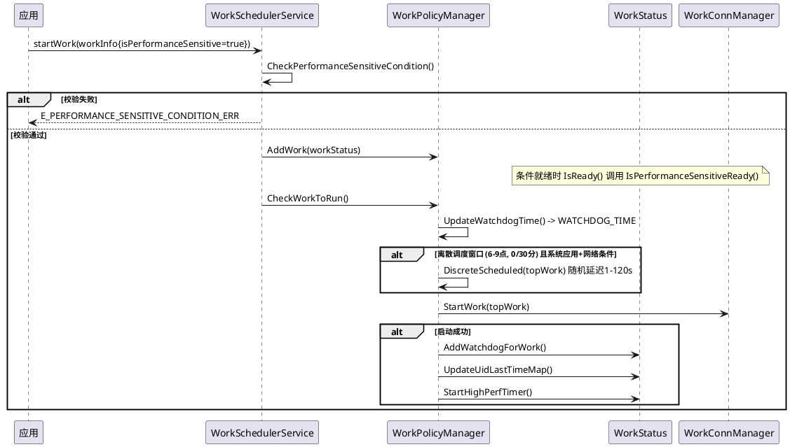
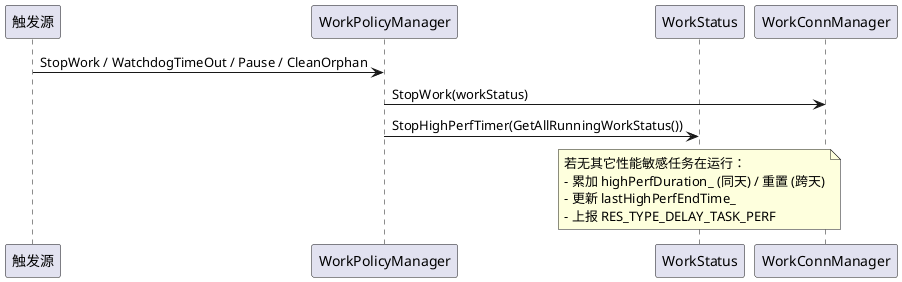

# 详细设计：WorkInfo 增加 isPerformanceSensitive

> 变更编号：20261020311883
> 关联 PR：[openharmony/resourcechedule_work_scheduler#793](https://gitcode.com/openharmony/resourcechedule_work_scheduler/pull/793)
> 编写日期：2026-10-30

## 1. 数据模型变更

### 1.1 WorkInfo 新增字段

定义于 `frameworks/include/work_info.h`：

| 字段 | 类型 | 默认值 | 说明 |
|---|---|---|---|
| `isPerformanceSensitive_` | `bool` | `false` | 延迟任务在高性能 CPU 核心上运行；设为 `true` 时须同时满足 `isDeepIdle=true` 和 `isCharging=true`，该任务一天只能运行一次 |

新增方法：

| 方法 | 签名 | 说明 |
|---|---|---|
| `RequestPerformanceSensitive` | `void RequestPerformanceSensitive(bool)` | 设置性能敏感标记 |
| `IsPerformanceSensitive` | `bool IsPerformanceSensitive() const` | 查询性能敏感标记 |

拷贝构造中同步复制 `isPerformanceSensitive_`（work_info.h:56）。

### 1.2 WorkStatus 新增成员

定义于 `services/native/include/work_status.h`：

**静态字段（进程级共享，受 `mutex_` 保护）：**

| 字段 | 类型 | 默认值 | 说明 |
|---|---|---|---|
| `performanceSensitiveLastTimeMap_` | `std::map<int32_t, time_t>` | 空 | uid → 上次性能敏感任务执行时间 |
| `highPerfStartTime_` | `uint64_t` | `0` | 当前高性能任务运行起始时间（进程级单例计时） |
| `highPerfDuration_` | `uint64_t` | `0` | 当日累计高性能运行时长（ms） |
| `lastHighPerfEndTime_` | `uint64_t` | `0` | 上次高性能任务运行结束时间，用于跨天判定 |

**锁重构：** 原 `s_uid_last_time_mutex` 与 `dumpAppGroupMutex_` 合并为单一静态 `mutex_`（`ffrt::mutex`），统一保护所有静态 map 与计数字段。

**新增方法：**

| 方法 | 可见性 | 签名 | 说明 |
|---|---|---|---|
| `IsPerformanceSensitiveReady` | private | `bool IsPerformanceSensitiveReady()` | 性能敏感就绪判定 |
| `IsNeedDiscreteScheduled` | public | `bool IsNeedDiscreteScheduled()` | 是否需离散调度 |
| `StartHighPerfTimer` | public | `void StartHighPerfTimer()` | 启动高性能运行计时 |
| `StopHighPerfTimer` | public | `void StopHighPerfTimer(const std::vector<std::shared_ptr<WorkStatus>> &)` | 停止高性能运行计时 |
| `GetPerformanceSensitiveLastTime` | public static | `bool GetPerformanceSensitiveLastTime(int32_t, time_t&)` | 查询 uid 上次执行时间 |
| `GetHighPerfStartTime` | public static | `uint64_t GetHighPerfStartTime()` | 高性能起始时间读 |
| `SetHighPerfStartTime` | public static | `void SetHighPerfStartTime(uint64_t)` | 高性能起始时间写 |
| `GetHighPerfDuration` | public static | `uint64_t GetHighPerfDuration()` | 当日累计时长读 |
| `SetHighPerfDuration` | public static | `void SetHighPerfDuration(uint64_t)` | 当日累计时长写 |
| `GetLastHighPerfEndTime` | public static | `uint64_t GetLastHighPerfEndTime()` | 上次结束时间读 |
| `SetLastHighPerfEndTime` | public static | `void SetLastHighPerfEndTime(uint64_t)` | 上次结束时间写 |

### 1.3 常量与错误码

`utils/native/include/work_sched_constants.h`：

| 常量 | 值 | 说明 |
|---|---|---|
| `MAX_HIGH_PERF_DURATION` | `10 * 60 * 1000` | 当日全设备高性能任务累计运行时长上限（10 分钟） |
| `ONE_DAY_MS` | `24 * 60 * 60 * 1000` | 单应用性能敏感任务最小间隔（24 小时） |
| `DELAY_TASK_PERF_START` | `1` | DFX 事件值：开始 |
| `DELAY_TASK_PERF_END` | `0` | DFX 事件值：结束 |

`utils/native/include/work_sched_errors.h`：

| 错误码 | 含义 |
|---|---|
| `E_PERFORMANCE_SENSITIVE_CONDITION_ERR` | `isPerformanceSensitive=true` 时未同时设置 `isDeepIdle`/`isCharging`，或重复任务周期 < 24h |
| `E_IS_PERFORMANCE_SENSITIVE_ERR` | napi 参数 `isPerformanceSensitive` 类型非 boolean |

## 2. 核心逻辑设计

### 2.1 条件校验（申请阶段）

`WorkSchedulerService::CheckPerformanceSensitiveCondition`（work_scheduler_service.cpp:782），在 `StartWorkInner`（:824）和 `AddWorkInner`（:858）中调用：

```
输入: WorkInfo& workInfo
逻辑:
  if (!workInfo.IsPerformanceSensitive())         → return true   // 非性能敏感，直接通过
  if (workInfo.GetDeepIdle() != DEEP_IDLE_IN)     → return false  // 必须深度空闲
  if (workInfo.GetChargerType() >= CHARGING_UNPLUGGED) → return false  // 必须充电
  uint32_t timeInterval = workInfo.GetTimeInterval();
  if (timeInterval > 0 && timeInterval < ONE_DAY_MS) → return false  // 重复周期须 >= 24h
  → return true
失败时返回: E_PERFORMANCE_SENSITIVE_CONDITION_ERR
```

### 2.2 就绪判定（运行阶段）

`WorkStatus::IsReady()`（work_status.cpp:278）在常规条件判定后追加性能敏感检查（:297），并将最小间隔判定重构为独立函数 `IsMinIntervalReady()`：

```
if (workInfo_->IsPerformanceSensitive() && !IsPerformanceSensitiveReady()) {
    return false;
}
// ... 能效白名单、分组间隔判定 ...
return IsMinIntervalReady();   // 最小间隔判定（原内联逻辑提取）
```

`IsMinIntervalReady()`（work_status.cpp:316）：原 `IsReady()` 末尾的 uid 初次触发/最早开始时间/间隔比较逻辑，提取为独立函数，降低 `IsReady()` 圈复杂度。

```
if (!GetUidLastTime(uid_, lastTime)):
  if (CheckEarliestStartTime()) → return false
  conditionStatus_ += "firstTrigger"
  → return true
del = difftime(getOppositeTime(), lastTime)
if (del < minInterval_):
  needRetrigger_ = true; timeRetrigger_ = minInterval_ - del + ONE_SECOND
  → return false
→ return true
```

`IsPerformanceSensitiveReady()`（work_status.cpp:346）：

```
步骤1 跨天清零:
  if (!IsSameDay(currentTimeMs, GetLastHighPerfEndTime()))
    SetHighPerfDuration(0)

步骤2 全局限额:
  if (GetHighPerfDuration() >= MAX_HIGH_PERF_DURATION)
    → return false  (conditionStatus_ += "highPerfDuration&NOT_OK")

步骤3 单应用频率控制:
  if (GetPerformanceSensitiveLastTime(uid_, lastTime)):
    del = difftime(getOppositeTime(), lastTime)
    if (del < ONE_DAY_MS):
      needRetrigger_ = true
      timeRetrigger_ = int(ONE_DAY_MS - del + ONE_SECOND)
      → return false  (conditionStatus_ += "performanceSensitive&NOT_OK")

  → return true
```

### 2.3 看门狗时长

`WorkPolicyManager::UpdateWatchdogTime`（work_policy_manager.cpp:536）：

```
if (topWork->workInfo_->IsPerformanceSensitive()):
  SetWatchdogTime(WATCHDOG_TIME)   // 固定 2 分钟
  return
```

### 2.4 离散调度

`WorkPolicyManager::IsNeedDiscreteScheduled`（work_policy_manager.cpp:1011）：

```
窗口判定: 6:00 <= tm_hour <= 9 且 tm_min ∈ {0, 30}
```

`WorkPolicyManager::DiscreteScheduled`（work_policy_manager.cpp:1030）：

```
1. 以 getOppositeTime()+getpid()+gettid() 为种子
2. delay = rand() % 120 + 1   (1~120 秒)
3. handler->PostTask(task, delay * 1000)
4. task 内: UpdateWorkBeforeRealStart → StartWork → AddWatchdogForWork
            → UpdateUidLastTimeMap → StartHighPerfTimer
```

`WorkStatus::IsNeedDiscreteScheduled`（work_status.cpp:949）：

```
条件: workInfo_ != nullptr
      && workInfo_->IsCallBySystemApp()
      && conditionMap_ 含 NETWORK 条件
      && workConditionMap 含 NETWORK 条件
      && IsBatteryAndNetworkReady(NETWORK) 为 true
```

### 2.5 高性能运行计时生命周期

| 时机 | 调用 | 调用位置 |
|---|---|---|
| 任务真实启动成功 | `StartHighPerfTimer()` | `RealStartWork`（:525）、`DiscreteScheduled`（:1043） |
| 任务暂停 | `StopHighPerfTimer(runningWorks)` | `PauseRunningWorks`（:905） |
| 任务恢复 | `StartHighPerfTimer()` | `ResumePausedWorks`（:936） |
| 任务停止/超时/清理 | `StopHighPerfTimer(runningWorks)` | `StopWork`（:229）、`CleanOrphanWork`（:1095） |

`StartHighPerfTimer`（work_status.cpp:1125）：

```
if (!workInfo_->IsPerformanceSensitive()) → return
lock(mutex_)
if (highPerfStartTime_ != 0) → return    // 已有计时中，不覆盖
highPerfStartTime_ = GetCurrentTimeMs()
ReportDelayTaskPerf(uid_, DELAY_TASK_PERF_START)
```

`StopHighPerfTimer`（work_status.cpp:1138）：

```
if (!workInfo_->IsPerformanceSensitive()) → return
for (work : runningWorks):
  if (work != this && work->IsPerformanceSensitive()) → return  // 仍有其它任务运行，不停止
currentDuration = currentTime - workStartTime_      // 注: workStartTime_ 读取未加 statusMutex_
isSameDay = IsSameDay(currentTime, GetLastHighPerfEndTime())
lock(mutex_)
if (isSameDay):
  highPerfDuration_ += currentDuration
else:
  highPerfDuration_ = currentDuration
highPerfStartTime_ = 0
lastHighPerfEndTime_ = currentTime
ReportDelayTaskPerf(uid_, DELAY_TASK_PERF_START)    // 注: type 值待修正为 END
```

### 2.6 频率控制记录

`WorkStatus::UpdateUidLastTimeMap`（work_status.cpp:691）在任务启动成功后调用：

```
lock(mutex_)
s_uid_last_time_map[uid_] = lastTime
if (workInfo_->IsPerformanceSensitive()):
  performanceSensitiveLastTimeMap_[uid_] = lastTime
```

`ClearUidLastTimeMap`（:701）在应用卸载时清除两个 map。

## 3. 运行时序

### 3.1 启动时序



### 3.2 停止时序



## 4. 接口变更设计

### 4.1 IPC 序列化

`frameworks/src/work_info.cpp`，提取辅助方法并调整序列化结构：

| 方法 | 职责 |
|---|---|
| `MarshallCondition(Parcel&)` | 序列化条件 map（从 `Marshalling` 中提取） |
| `ReadBaseFields(Parcel&, WorkInfo*)` | 读取基础字段 + 条件 map + `isPerformanceSensitive` |
| `ReadExtras(Parcel&, WorkInfo*)` | 读取 extras 存在性 + WantParams |

序列化顺序：

```
workId | bundleName | abilityName | earliestStartTime | persisted | triggerType | uid
| conditionMap(size + entries) | isPerformanceSensitive  <-- 新增
| hasExtras | [extras]
```

**兼容性：** 旧版本 Parcel 不含 `isPerformanceSensitive`，跨版本 IPC 不兼容。持久化 JSON 通过 `IsHasBoolProp` 容错，向后兼容。

### 4.2 JSON 持久化

`ParseToJsonStr`（work_info.cpp:496）：`root["isPerformanceSensitive"] = isPerformanceSensitive_`

`ParseFromJson`（work_info.cpp:600）：

```
if (IsHasBoolProp(value, "isPerformanceSensitive")):
  this->isPerformanceSensitive_ = value["isPerformanceSensitive"].get<bool>()
```

### 4.3 napi 接口

`interfaces/kits/js/napi/src/common.cpp`：

- `GetBaseWorkInfo`（:86）：`GetBoolProperty(env, objValue, "isPerformanceSensitive", E_IS_PERFORMANCE_SENSITIVE_ERR)`，默认 `false`。
- `GetNapiWorkInfo`（:447）：回写 `isPerformanceSensitive` 到 napi 对象。
- 提取 `SetTimerAndExtrasInfo` 方法，拆分定时器/extras 设置。

### 4.4 taihe / ANI 接口

- IDL（`ohos.resourceschedule.workScheduler.taihe`）：`WorkInfoInner` 与 `WorkInfo` 结构新增 `isPerformanceSensitive: Optional<bool>`。
- `common.cpp`（taihe）：`GetBaseWorkInfo` 读取、`ParseWorkInfo` 回写。
- `ani_work_scheduler_extension`：新增 `SetPerformanceSensitiveInfo`，`OnWorkStart` 透传字段至 ANI 侧。

## 5. DFX 设计

### 5.1 事件上报

`WorkStatus::ReportDelayTaskPerf`（work_status.cpp:1202）：

```
ReportDataInProcess(ResType::RES_TYPE_DELAY_TASK_PERF, type, {"uid": to_string(uid)})
```

| 触发点 | type |
|---|---|
| `StartHighPerfTimer` | `DELAY_TASK_PERF_START (1)` |
| `StopHighPerfTimer` | `DELAY_TASK_PERF_START (1)` （注：待修正为 END） |

### 5.2 hidumper

`WorkSchedulerService::DumpSetHighPerfDuration`：支持通过 hidumper 设置当日高性能累计运行时长。

## 6. 条件监听适配

`services/native/src/conditions/screen_listener.cpp`（:110）：

```
- saIdTimeInfoMap_[DEFAULT_SA_ID] = SaTimerInfo(MIN_DEEP_IDLE_SCREEN_OFF_TIME_MIN, 0);
+ saIdTimeInfoMap_[DEFAULT_SA_ID] = SaTimerInfo(g_deepIdleScreenOffTimeMin.load(), 0);
```

深度空闲屏幕关闭时长由编译期常量改为运行时可配的 `g_deepIdleScreenOffTimeMin`，间接影响性能敏感任务的 `isDeepIdle` 条件就绪时机。

## 7. 并发与锁设计

### 7.1 锁层次

```
WorkQueueManager::mutex_ → WorkQueue::workListMutex_ → conditionMapMutex_ → mutex_(static)
                                                           ↘ statusMutex_
WorkPolicyManager::uidMapMutex_ → conditionMapMutex_ → mutex_(static)
                                     ↘ statusMutex_
```

### 7.2 安全性分析

- `mutex_` 为非递归 `ffrt::mutex`，持有期间不回调任何会再次获取 `mutex_` 的函数
- `conditionMapMutex_` → `mutex_` 存在于 `IsConditionReady` → `IsTimerReady` → `GetUidLastTime`，无反向获取
- `statusMutex_` 完全独立，持有期间不调用其它锁
- 无 AB-BA 死锁

### 7.3 已知问题

| 问题 | 位置 | 影响 |
|---|---|---|
| `StopHighPerfTimer` 读取 `workStartTime_` 未加 `statusMutex_` | work_status.cpp:1149 | 数据竞争，待优化 |
| `UpdateWatchdogTime` 直接访问 `conditionMap_` 未加 `conditionMapMutex_` | work_policy_manager.cpp:557 | 数据竞争，待优化 |
| `conditionStatus_`/`groupChanged_`/`minInterval_` 多处无锁访问 | work_status.cpp 多处 | 数据竞争，待优化 |

### 7.4 本次重构

本次变更将 `IsReady()` 末尾的最小间隔判定逻辑（uid 初次触发/最早开始时间/间隔比较）提取为独立函数 `IsMinIntervalReady()`，降低 `IsReady()` 圈复杂度，与既有 `IsConditionReady`、`IsPerformanceSensitiveReady` 等拆分风格保持一致。

## 8. 测试设计

### 8.1 frameworks 测试（workinfo_test.cpp）

| 用例 | 验证点 |
|---|---|
| `RequestPerformanceSensitive001` | 默认 false；set true 后返回 true；set false 后返回 false |

### 8.2 services 测试

**work_status_test.cpp：**

| 用例 | 验证点 |
|---|---|
| `StartHighPerfTimer_001` | 非性能敏感任务不启动计时，`GetHighPerfStartTime() == 0` |
| `StartHighPerfTimer_002` | 连续调用两次，第二次不覆盖第一次的起始时间 |
| `StopHighPerfTimer_001` | 有其它性能敏感任务运行时提前返回，`highPerfStartTime_` 不被置零 |
| `StopHighPerfTimer_002` | 跨天重置 `highPerfDuration_` 为本次运行时长，`highPerfStartTime_` 置零 |
| `StopHighPerfTimer_004` | 同天累加 `highPerfDuration_`，验证累加值在预期区间 `[preset+2500, preset+5000]` |
| `StopHighPerfTimer_005` | 跨天重置 `highPerfDuration_` 为本次运行时长，验证值在区间 `[2500, 5000]`，`highPerfStartTime_` 置零 |
| `IsPerformanceSensitiveReady_001` | 累计超限返回 false |
| `IsPerformanceSensitiveReady_002` | 满足条件返回 true |
| `HighPerfStaticMembers_001` | 静态 getter/setter 读写正确 |

**workschedulerservice_test.cpp：**

| 用例 | 验证点 |
|---|---|
| `CheckPerformanceSensitiveCondition_001` | 非性能敏感通过 |
| `CheckPerformanceSensitiveCondition_002` | 缺 deepIdle 失败 |
| `CheckPerformanceSensitiveCondition_003` | 缺 charging 失败 |
| `CheckPerformanceSensitiveCondition_004` | 重复周期 < 24h 失败 |
| `CheckPerformanceSensitiveCondition_005` | 重复周期 >= 24h 通过 |

**screen_listener_test.cpp：** 深度空闲屏幕关闭时长可配相关用例。

## 9. 文件清单

| 文件 | 变更行数 |
|---|---|
| docs/design/work_scheduler.md | +1 |
| docs/spec/work_scheduler.md | +2 |
| frameworks/include/work_info.h | +17 |
| frameworks/src/work_info.cpp | +79 -46 |
| frameworks/test/unittest/src/workinfo_test.cpp | +16 |
| interfaces/kits/ets/taihe/work_scheduler/idl/ohos.resourceschedule.workScheduler.taihe | +2 |
| interfaces/kits/ets/taihe/work_scheduler/src/common.cpp | +4 |
| interfaces/kits/ets/taihe/work_scheduler_extension/include/ani_work_scheduler_extension.h | +1 |
| interfaces/kits/ets/taihe/work_scheduler_extension/src/ani_work_scheduler_extension.cpp | +12 |
| interfaces/kits/js/napi/include/common.h | +1 |
| interfaces/kits/js/napi/src/common.cpp | +17 -7 |
| services/native/include/work_scheduler_service.h | +2 |
| services/native/include/work_status.h | +21 -4 |
| services/native/src/conditions/screen_listener.cpp | +1 -1 |
| services/native/src/work_policy_manager.cpp | +15 |
| services/native/src/work_scheduler_service.cpp | +43 |
| services/native/src/work_status.cpp | +139 -5 |
| services/test/src/conditions/screen_listener_test.cpp | +19 |
| services/test/src/work_status_test.cpp | +175 |
| services/test/src/workschedulerservice_test.cpp | +82 |
| utils/native/include/work_sched_constants.h | +7 |
| utils/native/include/work_sched_errors.h | +6 |
